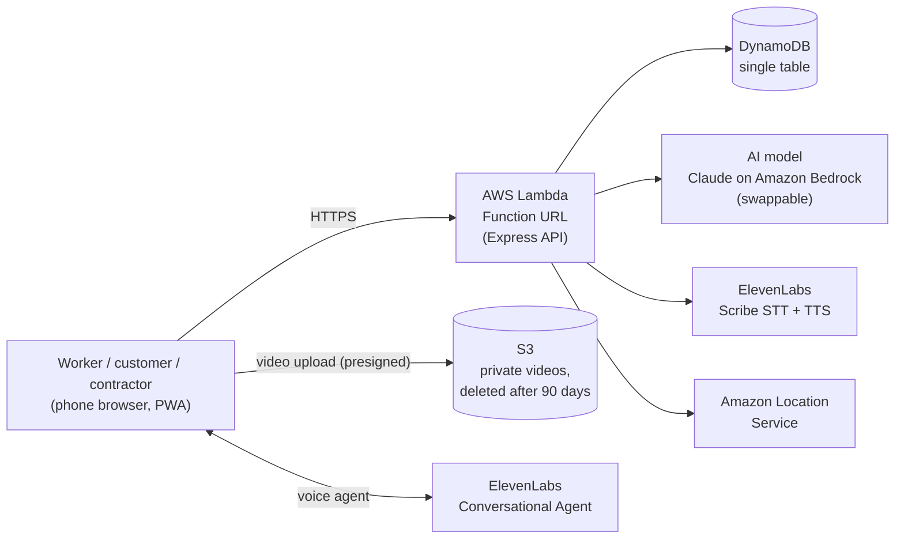

# SkilledIN

**Voice-first skill passports for India's blue-collar workers.** A worker proves a skill with a short live video challenge checked by AI, each finished job can add a customer stamp (stars and a voice note), and contractors hire nearby verified workers just by speaking.

> **"The job is the exam."**

Built by **Team Adversity** for **wHACKiest 2026**, **Track 4: UnlockED** (sub-problems #1 Skill Verification and #3 Hyper-Local Job Matching).
Powered by **ElevenLabs** (Scribe speech-to-text, multilingual text-to-speech, Conversational Agent) and **AWS** (Lambda, DynamoDB, S3, Bedrock, Location Service, Amplify, CDK).

---

## The problem

Most of India's electricians, plumbers and masons learned their trade on the job. They have real skill but no certificate, so:

- **No proof → no trust.** Contractors and households can't tell a skilled worker from an unskilled one, so they hire through word of mouth and pay everyone the same low rate.
- **No reach.** Work is found at labour chowks or through middlemen, limited to whoever happens to be nearby.
- **No record.** Years of good work leave no trace that a worker can carry to the next job.

Existing options either verify skills slowly through an in-person assessor, or list jobs based on skills people simply claim about themselves. Many workers also read with difficulty, so text-heavy apps don't reach them.

## The solution

SkilledIN turns a short, real piece of work into portable, checkable proof, and connects that proof straight to hiring. Every screen speaks, and every voice input is read back for confirmation, in **English, Hindi and Kannada**.

| Step | Who | What happens |
|---|---|---|
| 1. Sign up by voice | Worker | Says their name, trade and area. The app reads it back to confirm, then takes a phone number on a big keypad. |
| 2. Prove a skill live | Worker | Gets a task (e.g. "wire a switch and socket") and a random code. Records the work in the app, saying the code on camera. AI checks each step against a safety checklist. |
| 3. Get a QR passport | Worker | Passed skills appear as badges on a public passport page, shareable on WhatsApp or as a QR code. The worker's phone number is never shown on it. |
| 4. Collect stamps | Customer | After a job, the customer scans the QR and leaves a star rating plus a short voice note. |
| 5. Hire by voice | Contractor | Tells an AI voice agent what they need ("two electricians in Jayanagar tomorrow"). It finds verified workers within 10 km and says why each one fits. Workers accept the offer; only then can the contractor call them. |

### Launch skills

| Trade | Challenge | Safety-critical steps |
|---|---|---|
| Electrician | Wire a switch and socket | power off, tester used, switch on the phase wire |
| Plumber | Replace a leaking tap washer | main valve closed, no leak at the end |
| Mason | Lay a level brick course | spirit level checked |

A new trade is one new entry in `backend/src/data/skills.json`.

## How a skill check is decided

**The AI scores; fixed code decides.** The model looks at up to 6 frames from the video plus the transcript, and reports each checklist step as `seen`, `not_seen` or `unclear`. It also reports whether the code was spoken, a replay risk, a score and a confidence. Then `backend/src/lib/scoring.ts` applies these rules in order:

| # | Rule | Result |
|---|---|---|
| 1 | The random code wasn't spoken | FAIL |
| 2 | A safety step was clearly skipped | FAIL |
| 3 | A safety step couldn't be seen | REVIEW |
| 4 | The video looks filmed off a screen or photo | REVIEW |
| 5 | The AI's confidence is below 0.5 | REVIEW |
| 6 | Score is 60 or more | PASS |
| 7 | Otherwise | FAIL |

If the AI call fails, or its answer is missing any field, the attempt is saved as **REVIEW**. It never gets a default score. Every non-pass result comes with a spoken retake tip. Only PASS badges appear on the public passport.

**Hard to fake:** each challenge has a fresh random code that expires in 15 minutes, recording happens only in the in-app camera (no uploads from the gallery), and the AI flags videos that look replayed from another screen.

**Trust levels** on the passport: 0 Registered → 1 Verified (a passed skill) → 2 Experienced (plus 3 or more stamps averaging 4★) → 3 Master (2 passed skills, plus 10 or more stamps averaging 4.5★).

## Architecture



| Layer | Tech |
|---|---|
| Frontend | React, Vite, TypeScript, Tailwind CSS, installable PWA; hosted on AWS Amplify |
| Backend | One AWS Lambda (Node.js 22, TypeScript) behind a Function URL; zod validates every input |
| Data | DynamoDB single table; S3 private bucket, uploads via presigned POST |
| AI | Claude Opus 5.5 on Amazon Bedrock by default, switchable by env var (see below) |
| Voice | ElevenLabs Scribe (speech-to-text), multilingual TTS, Conversational Agent with a `find_workers` tool |
| Maps | A built-in list of Bengaluru localities first, Amazon Location Service on a miss |
| Infra | AWS CDK v2 (TypeScript) |

### Repo layout

```
backend/    Express API (runs locally and on Lambda)
  src/routes/   skills, workers, challenges, jobs, stamps, voice
  src/lib/      scoring.ts (badge rules, trust, ranking), ai.ts (model providers),
                assess.ts (prompts + answer checks), db, s3, geo, phone, elevenlabs
  src/data/     skills.json, localities.json, tips.json
  test/         unit tests (node:test)
frontend/   React PWA (pages: Landing, WorkerOnboard, WorkerHome, Challenge, Passport, Hire, RateWorker)
infra/      AWS CDK stack (DynamoDB, S3, Lambda + Function URL, IAM)
.githooks/  commit-msg hook (see Contributing)
```

### API

| Method | Path | Purpose |
|---|---|---|
| GET | `/api/health` | Health check |
| GET | `/api/skills` | Skill catalogue |
| POST | `/api/workers/parse` | Turn a spoken sign-up into name, trade and area |
| POST | `/api/workers` | Create a worker (phone numbers are normalised and must be unique) |
| GET | `/api/workers/:id` | Public passport (PASS badges, stamps, trust level; no phone number) |
| GET | `/api/workers/:id/offers` | Job offers for a worker |
| POST | `/api/challenges` | Start a challenge: random code + upload URL |
| POST | `/api/challenges/:id/submit` | Grade the frames and transcript, save the badge |
| POST | `/api/jobs` | Contractor request: ranked nearby matches, each with a reason |
| GET | `/api/jobs/:id` | Job status (the contractor's phone appears only once a worker accepts) |
| POST | `/api/jobs/:id/accept` | Worker accepts an offer |
| POST | `/api/stamps` | Customer rating and voice note |
| POST | `/api/voice/transcribe`, `/api/voice/tts` | Speech-to-text and text-to-speech |

## Getting started

**Needs:** Node.js 22 and npm. For the full cloud setup you also need an AWS account (with Bedrock model access enabled for your chosen model) and an ElevenLabs API key.

```powershell
npm install
copy .env.example .env      # fill in the values you have
npm run seed                # 8 fictional demo workers
npm run dev                 # backend on :3001 and frontend on :5173
```

Open http://localhost:5173. Try a seeded passport at http://localhost:5173/p/w_ravi_elec.

**Works without cloud keys:** with no AWS or ElevenLabs settings, local dev uses an in-memory store and offline stand-ins for the AI and voice, so every screen can be tried. On Lambda the stand-ins are switched off, and a skill check without a working AI goes to REVIEW.

Other commands:

```powershell
npm run check               # TypeScript check in all workspaces
npm test                    # backend unit tests
npm run dev:backend         # backend only
npm run dev:frontend        # frontend only
```

### Configuration (`.env` in the repo root)

| Variable | Purpose |
|---|---|
| `AWS_REGION`, `AWS_PROFILE` | AWS account used by the backend and CDK |
| `TABLE_NAME`, `BUCKET_NAME` | From the CDK deploy outputs |
| `ALLOWED_ORIGINS` | Comma-separated origins allowed to call the API |
| `AI_PROVIDER`, `AI_MODEL_ID`, `AI_REGION`, `AI_EFFORT`, `AI_BASE_URL`, `AI_API_KEY` | AI model choice (next section) |
| `ELEVENLABS_API_KEY`, `ELEVENLABS_STT_MODEL`, `ELEVENLABS_TTS_MODEL`, `ELEVENLABS_VOICE_ID` | Voice (server-side only) |

The frontend reads only public values from `frontend/.env.local`: `VITE_API_BASE_URL` and `VITE_ELEVENLABS_AGENT_ID`. Secrets never go to the browser.

### Choosing the AI model

Every model call goes through `backend/src/lib/ai.ts`. Hosts switch models with env vars, no code changes:

| `AI_PROVIDER` | Calls | `AI_MODEL_ID` example |
|---|---|---|
| `claude-bedrock` (default) | Claude on Amazon Bedrock | `anthropic.claude-opus-5-5`, `anthropic.claude-sonnet-5-5`, `anthropic.claude-haiku-5-5` |
| `bedrock-converse` | Amazon Nova or another Bedrock model that reads images | a model ID from the Bedrock console |
| `openai-compatible` | Any `/chat/completions` endpoint: OpenRouter or NVIDIA (free models available), or a self-hosted open model on Ollama or vLLM. Set `AI_BASE_URL`, plus `AI_API_KEY` if needed | the endpoint's model name. A comma-separated list is tried in order, e.g. `nvidia/nemotron-3.5-super-vl:free,google/gemma-4-31b-it:free` with `AI_BASE_URL=https://openrouter.ai/api/v1` |

Smaller models cost far less per check (roughly ₹5 on Opus 5.5 versus under ₹1 on Haiku 5.5, estimated from list prices). The pass/fail rules stay the same whichever model answers. Re-test on real clips after switching, and check a provider's data-use terms before sending workers' video frames outside AWS.

### Deploy

```powershell
npm exec -w infra -- cdk bootstrap   # once per AWS account and region
npm run deploy -w infra     # creates DynamoDB, S3, Lambda and the Function URL
```

Put the deploy outputs (`TableName`, `BucketName`, `FunctionUrl`) into `.env` and `frontend/.env.local`. Then host the frontend on AWS Amplify by connecting this repository. HTTPS is needed for camera and microphone access on phones.

## Privacy and security

- Videos are private in S3 and deleted after 90 days. The public passport never shows a phone number, a video or a transcript.
- A contractor sees a worker's phone number only after the worker accepts their offer.
- Speech transcripts are treated as untrusted data in AI prompts, and the model never decides a badge by itself.
- API keys live only in the backend environment. Nothing secret is in this repository or the frontend.

## Contributing

Commits are authored by team members only. AI tools must not be credited as authors or co-authors. Turn on the hook that enforces this, once per clone:

```powershell
git config core.hooksPath .githooks
```

## Team

| Name | Role |
|---|---|
| Syed Raiyan (Lead) | AWS backend & infra |
| Syed Junaid Khalander | Frontend & ElevenLabs voice |
| Shreyas S Kiragi | PPT, architecture diagram, demo video, README |

## Status

Hackathon MVP. All screens and API routes work locally. The cloud deploy and real AI and voice calls are being tested.
